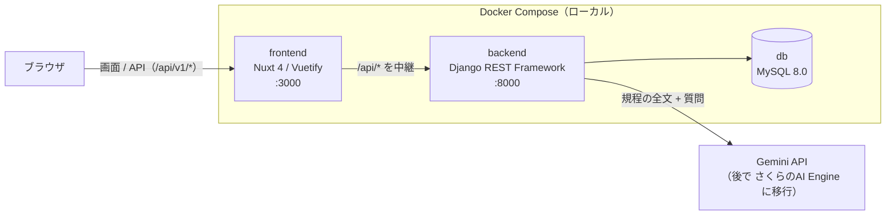
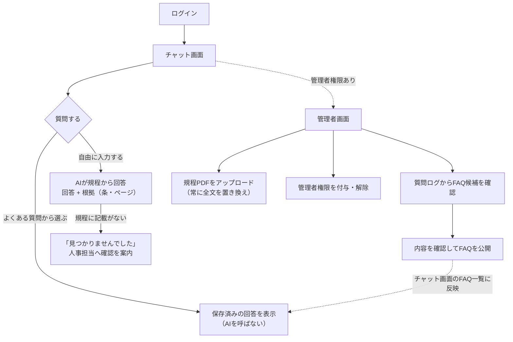
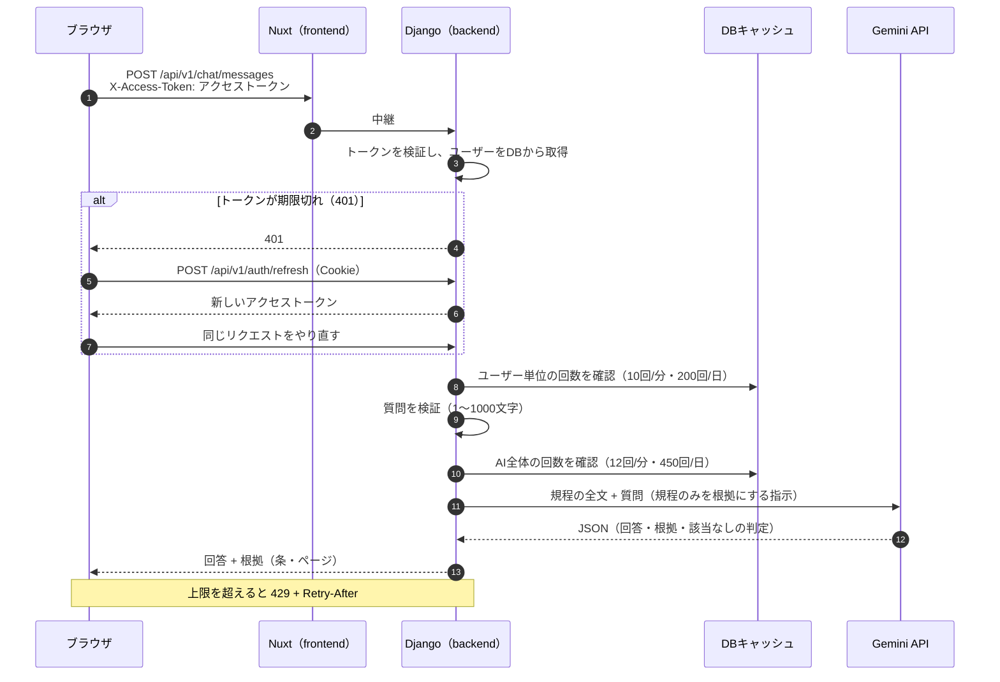
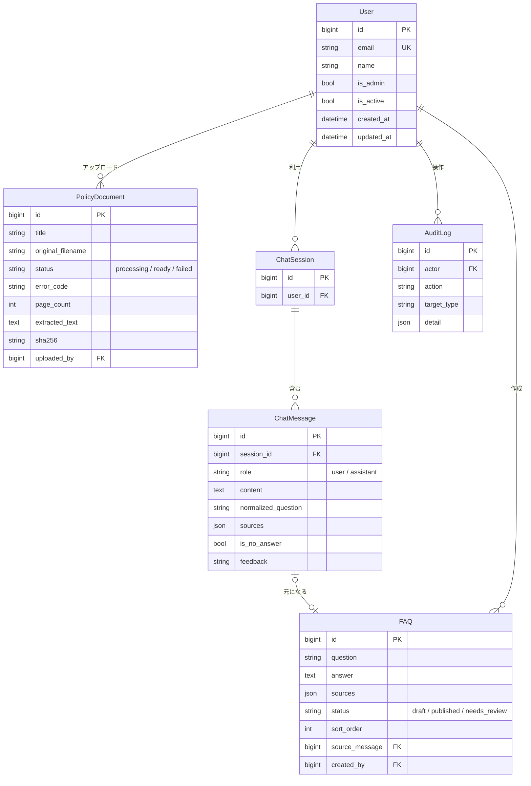

# 就業規則アプリ

就業規則のPDFを管理者がアップロードし、社員がチャット形式で質問すると、就業規則の記載内容に基づいてAIが回答するWebアプリ。

> 開発中です。実装済みの範囲は、下の「実装状況」を参照してください。

## 技術スタック

- フロントエンド: Nuxt 4 / Vue 3 / Vuetify 3（TypeScript、SPAモード）
- バックエンド: Django / Django REST Framework
- DB: MySQL
- AI: Gemini API（検証）→ さくらのAI Engine（移行予定）
- 環境: Docker / Docker Compose

## 実装状況

| 機能 | 状況 |
|---|---|
| ログイン・ログアウト、権限（管理者権限の有無）、レート制限 | 実装済み |
| チャット（Gemini、根拠つきの回答。管理者が登録した規程に基づく） | 実装済み |
| 規程PDFのアップロード（常に全文を置き換え） | 予定（フェーズ2） |
| 管理者権限の付与・解除 | 予定（フェーズ2） |
| 会話の文脈、チャットの履歴の保存 | 予定（フェーズ3） |
| さくらのAI Engineへの移行 | 予定（フェーズ4） |
| CSVでのユーザー取込、監査ログ、公開の準備 | 予定（フェーズ5） |
| FAQ（質問ログからの候補、公開、AIを呼ばない回答） | 追加機能として予定（フェーズ6） |

## 設計

以下の図は、目指している全体の設計です。実装済みの範囲は、上の「実装状況」を参照してください。

### システム構成



### ユーザーシナリオ



<details>
<summary>チャットの処理の流れ（シーケンス図）</summary>

質問1件が、どのように処理されるかを示します。



</details>

<details>
<summary>データ設計（ER図）</summary>

目指しているデータ設計です。実装済みなのは `User` だけで、ほかのテーブルは、次のフェーズで追加します。

| テーブル | 内容 | 状況 |
|---|---|---|
| User | ユーザー。管理者権限（`is_admin`）の有無を持つ | 実装済み |
| PolicyDocument | アップロードされた規程（抽出したテキストと、取り込みの状態を保存） | フェーズ2で実装中 |
| ChatSession / ChatMessage | チャットの会話と、質問・回答（根拠つき） | 予定（フェーズ3） |
| AuditLog | 重要な操作の記録 | 予定（フェーズ5） |
| FAQ | 公開するよくある質問と回答 | 追加機能として予定（フェーズ6） |



</details>

## サンプルファイル

`samples/` に、動作確認用の架空の就業規則（PDF）があります。詳しくは [samples/README.md](samples/README.md) を参照してください。

## 起動方法

### 前提
- Docker / Docker Compose（Docker Desktop など）がインストールされ、起動していること

### 手順
```bash
# 1. 環境変数ファイルを作成（値は必要に応じて編集）
cp .env.example .env
#    チャットを試す場合は、.env の GEMINI_API_KEY に Gemini の APIキーを設定する
#    （Google AI Studio https://aistudio.google.com で無料枠のキーを発行できます）

# 2. 起動（初回はイメージのビルドが入るため数分かかります）
docker compose up -d --build

# 3. DBのマイグレーションと、デモユーザーの作成（初回のみ）
make setup

# 4. 動作確認
curl http://127.0.0.1:8000/healthz
# => {"status":"ok","db":"ok"}

# 5. ブラウザで画面を開く
#    http://127.0.0.1:3000         ログイン画面（デモユーザーでログイン）
#    http://127.0.0.1:3000/chat    チャット画面（就業規則への質問）
#    http://127.0.0.1:3000/status  バックエンドとDBの接続状態（ログイン不要）
```

### ユーザーについて
- ユーザーの登録画面はありません。コマンドで作成します（`docker compose up -d` で起動している状態で実行）。

```bash
make migrate    # マイグレーションを適用
make seed       # デモユーザーを作成（.env の DEMO_PASSWORD がパスワード）
docker compose exec backend python manage.py create_user --email a@example.com --name 名前 [--admin]
docker compose exec backend python manage.py set_password --email a@example.com
```

- 新しいマイグレーションを含む変更を取り込んだ（`git pull` した）ときは、`make migrate` を実行してください。
- `create_user` と `set_password` は、`--password` を省略すると画面で入力を求めます（パスワードは12文字以上）。

デモユーザー（`make seed`）:

| メールアドレス | 権限 |
|---|---|
| admin@example.com | 管理者 |
| employee1@example.com 〜 employee3@example.com | 社員 |

### 画面とログイン
- 画面は、ログインしていないと開けません（開くと、ログイン画面に移ります。ログイン後は、元の画面に戻ります）。
- 管理者権限のあるユーザーには、ヘッダーに歯車アイコンが表示され、管理者画面（`/admin/...`）を開けます。管理者権限のないユーザーが開こうとすると、チャット画面に戻されます。
- アクセストークンはメモリにだけ保持し、ページを再読み込みしたときは、リフレッシュトークン（Cookie）で、ログイン状態を復元します。
- 画面の振り分けは、使いやすさのためのものです。権限のチェックは、バックエンドが行います。

### 規程のアップロード（管理者用API）
管理者権限のあるユーザーが、規程のPDFをアップロードすると、現行の規程を置き換えます（常に全文置換）。取り込みは、キュー（DB）とワーカーによる非同期処理です。

| メソッド | パス | 内容 |
|---|---|---|
| PUT | /api/v1/admin/policy | PDFをアップロード（multipart、項目名 `file`）。受け付けると `202`（状態: 処理中）を返す |
| GET | /api/v1/admin/policy | 現行の規程（`current`）と、処理中・直近で失敗した取り込み（`upload`）を返す。未登録でも `200`（どちらも `null`） |
| GET | /api/v1/admin/policy/file | 現行の規程のPDFを、ブラウザ内で表示できる形（`inline`）で返す。未登録は `404`（`POLICY_NOT_FOUND`） |

- 受け付けの段階で、20MB以下、PDFの先頭の署名（拡張子ではなく、ファイルの中身で判定）、現行の規程と同じファイルでないこと、処理中の規程がないこと（`409`）を確認します。
- ワーカー（`docker compose` の `worker` サービス）が、PDFからテキストを抽出して、正規化し（部首用の文字などを、通常の文字に直す）、ページの区切り（`[p.N]`）つきで保存します。成功すると、現行の規程になり、旧規程は削除されます。失敗したときは、旧規程が残ります。
- 取り込めないPDF（失敗の理由は、画面に表示します）: 壊れている・パスワード付き、文字を含まない（スキャンした画像）、文字化け、ページ数やテキストが多すぎる。
- 質問のたびに、規程の全文をAIへ送るため、長い規程は、AIの利用枠（トークン数/分）を圧迫します。そのため、テキストの長さに上限（既定20万文字）を設けています。

| 設定（`.env`） | 既定 | 内容 |
|---|---|---|
| `POLICY_MAX_UPLOAD_MB` | 20 | ファイルサイズの上限 |
| `POLICY_MAX_PAGES` | 500 | ページ数の上限 |
| `POLICY_MAX_TEXT_CHARS` | 200000 | 抽出したテキストの文字数の上限 |
| `POLICY_STALE_MINUTES` | 10 | 処理中のまま、この時間（分）を超えたら、失敗として扱う |
| `THROTTLE_POLICY_UPLOAD` | 10/hour | 管理者ごとのアップロードの回数 |

**対応していないPDF:** スキャンした画像のPDF、独自のフォントの割り当てで文字が正しく取り出せないPDF、段組みや表の読み取り順が崩れるもの。

### 管理者の管理API

| メソッド | パス | 内容 |
|---|---|---|
| GET | /api/v1/admin/admins | 管理者権限を持つ、有効なユーザーの一覧（ページング） |
| GET | /api/v1/admin/users | 管理者権限のない、有効なユーザーの一覧（ページング。`?q=` で名前・メールを部分一致で検索） |
| POST | /api/v1/admin/admins | `{"user_ids": [...]}` の全員に、管理者権限を付与する（`204`） |
| POST | /api/v1/admin/admins/revoke | `{"user_ids": [...]}` の全員から、管理者権限を外す（`204`） |

- ページングは、`?page=1&page_size=20`（最大100）。`{ "count", "page", "page_size", "results": [{ "id", "name", "email", "created_at" }] }` の形で返します。
- 付与・解除は、全員成功か、全員失敗です。存在しない・無効なユーザーが含まれると `400`（`INVALID_TARGET`）です。
- 解除では、自分自身を含むと `409`（`CANNOT_REVOKE_SELF`）、処理後に有効な管理者が0人になると `409`（`LAST_ADMIN`）です。管理者の行をロックして判定するため、同時に解除しても、0人にはなりません。

### 認証API
- ログインすると、アクセストークン（15分）がレスポンスで返り、リフレッシュトークン（7日）は HttpOnly の Cookie に入ります。
- 認証が必要なAPIには、アクセストークンを `X-Access-Token` ヘッダで送ります（公開時にBasic認証を前段に置いても干渉しないよう、`Authorization` ヘッダは使いません）。

| メソッド | パス | 内容 |
|---|---|---|
| POST | /api/v1/auth/login | ログイン（`email`、`password`） |
| POST | /api/v1/auth/refresh | アクセストークンの再発行（Cookie使用、リフレッシュトークンも入れ替え） |
| POST | /api/v1/auth/logout | ログアウト（リフレッシュトークンを無効化） |
| GET | /api/v1/me | ログイン中のユーザー情報（`X-Access-Token` が必要） |

```bash
curl -c cookie.txt -X POST http://127.0.0.1:8000/api/v1/auth/login \
  -H 'Content-Type: application/json' \
  -d '{"email":"admin@example.com","password":"demo-password"}'
curl http://127.0.0.1:8000/api/v1/me -H "X-Access-Token: <loginで返ったaccess>"
```

- チャットAPI（`POST /api/v1/chat/messages`）は、ログインが必要です。管理者権限の有無に関わらず、ログイン済みのユーザーなら使えます（未認証は 401）。
- `/api/v1/admin/` 配下は、管理者権限（`is_admin`）を持つユーザーだけが使えます（未認証は 401、管理者権限なしは 403）。動作確認用に `GET /api/v1/admin/ping` があります。権限は、トークンではなく DB の現在値で判定するため、変更は次のリクエストから反映されます。
- 管理者用 API は、`core.views.AdminAPIView` を継承して作り、`config/urls.py` の `admin_urlpatterns` に登録します。権限のテストが、登録されたすべての API を自動で検証します。
- レート制限（超過すると `429` と `Retry-After` ヘッダを返し、メッセージに待ち時間が入ります）。値は `.env` で変更できます。

| 対象 | 既定の制限 | エラーコード |
|---|---|---|
| ログイン（IPアドレス単位） | 10回/分 | `RATE_LIMITED` |
| ログイン（アカウント単位） | 5回連続で失敗すると15分ロック（正しいパスワードでも不可） | `LOGIN_LOCKED` |
| チャット（ユーザー単位） | 10回/分、200回/日 | `RATE_LIMITED` |
| チャット（AI全体＝全ユーザー合計） | 12回/分、450回/日（Gemini無料枠の15回/分・500回/日に余裕を持たせた値） | `AI_BUSY` |

- 回数の記録は、DBキャッシュ（`cache_table`）に保存します。テーブルは、`make migrate` で作られます。
- 公開時に前段のプロキシ（Caddyなど）を置く場合は、`.env` の `TRUSTED_PROXY_COUNT` にプロキシの段数（通常は `1`）を設定してください。`0`（既定）のときは `X-Forwarded-For` を信用せず、接続元のIPアドレスを使います。
- エラーは、すべて `{ "error": { "code": "...", "message": "..." } }` の形で返ります。
- `DJANGO_SECRET_KEY` はトークンの署名にも使うため、`DJANGO_DEBUG=false` の環境では32文字以上が必要です。

### AIについて
- 管理者が登録した現行の規程に基づいて回答します。規程が未登録のときは、AIを呼ばず、`409`（`POLICY_NOT_REGISTERED`）を返します。登録の有無は、`GET /api/v1/policy/status`（ログイン済みなら誰でも）で確認できます。
- 使用するモデルは `.env` の `GEMINI_MODEL` で変更できます。無料枠では、モデルによって混雑や提供終了で失敗することがあります。
- APIキーなしで画面を確認したい場合は、`.env` の `RAG_BACKEND=fake` にすると、AIを呼ばず固定の回答を返します。

### 停止
```bash
docker compose down        # コンテナを停止・削除（DBのデータは残る）
docker compose down -v     # DBのデータも含めて削除
```

### サービスとポート
| サービス | 内容 | ホスト側のアドレス |
|---|---|---|
| frontend | Nuxt（開発サーバー） | http://127.0.0.1:3000 |
| backend | Django（開発サーバー） | http://127.0.0.1:8000 |
| worker | 規程のPDFの取り込み（ポートなし） | ― |
| db | MySQL 8.0 | 127.0.0.1:3307（DBクライアントからの接続用） |

- ポートはすべて `127.0.0.1` にのみ公開しています。ホストにMySQLが入っていても競合しないよう、DBは3307にしています（`.env` の `DB_HOST_PORT` で変更可）。
- `frontend` と `backend` はソースをマウントしているため、コードを変更すると自動で反映されます。
- ブラウザからのAPI呼び出しは、同一オリジンの `/api/v1/*` に送り、Nuxtがバックエンドへ中継します（CORS設定が不要）。

### 開発（Lint・テスト）
`docker compose up -d` で起動している状態で、次のコマンドを実行します。

```bash
make lint-backend   # ruff（Lint・フォーマット確認）
make fmt-backend    # ruff（自動修正・整形）
make test-backend   # pytest（テスト用DBを作成するため、rootで接続）

make lint-frontend       # ESLint（関数はアロー関数に統一）
make fmt-frontend        # ESLint（自動修正）
make typecheck-frontend  # 型チェック（vue-tsc）
```

- 変更は、PR 作成時に GitHub Actions（`backend.yml` / `frontend.yml`）で、同じ内容が自動で検査されます。
- フロントの依存パッケージ（`package.json`）を変更したときは、`docker compose up -d --build -V` で起動し直してください。`node_modules` はコンテナ内の保存領域に残るため、`-V` を付けないと古いまま使われます。

### ログの確認
```bash
docker compose logs -f backend   # frontend も同様
```
