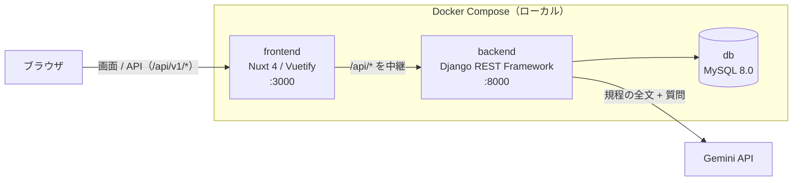
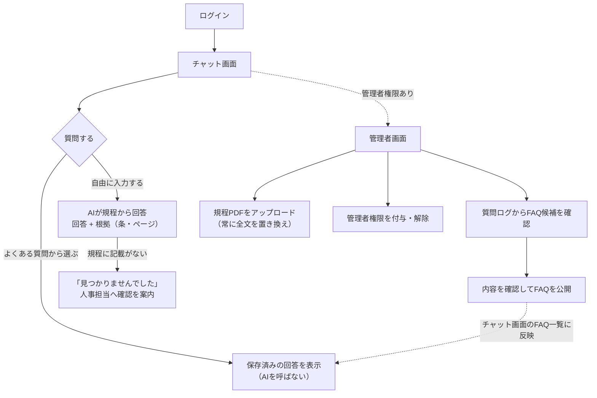
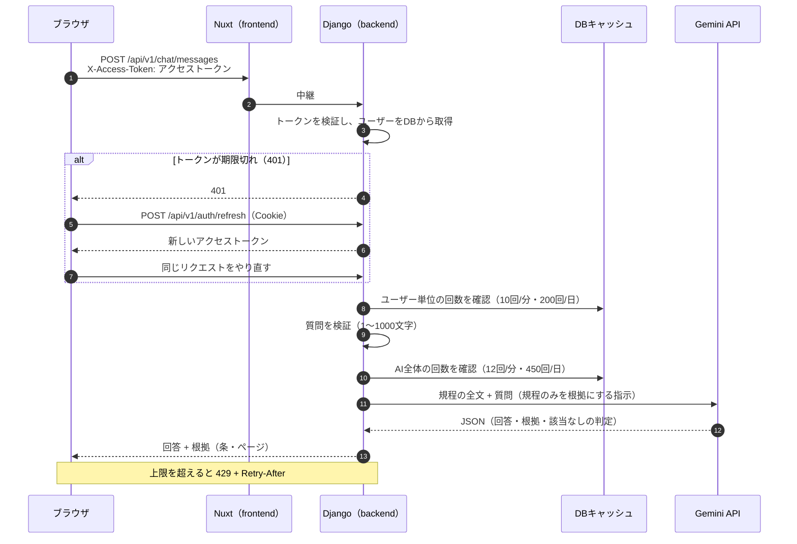
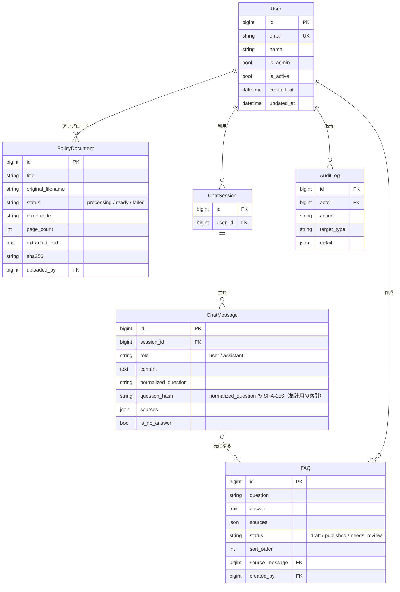

# 就業規則アプリ

就業規則のPDFを管理者がアップロードし、社員がチャット形式で質問すると、就業規則の記載内容に基づいてAIが回答するWebアプリ。

> v1.0.0。動かして確かめる手順は、「起動方法」と「デモの手順」を参照してください。

## 技術スタック

- フロントエンド: Nuxt 4 / Vue 3 / Vuetify 3（TypeScript、SPAモード）
- バックエンド: Django / Django REST Framework
- DB: MySQL
- AI: Gemini API（接続先は、`RagClient` で抽象化していて、差し替えられる）
- 環境: Docker / Docker Compose

## 実装状況

| 機能 | 状況 |
|---|---|
| ログイン・ログアウト、権限（管理者権限の有無）、レート制限 | 実装済み |
| チャット（Gemini、根拠つきの回答。管理者が登録した規程に基づく） | 実装済み |
| 規程PDFのアップロード（常に全文を置き換え。PDFのプレビュー） | 実装済み |
| 管理者権限の付与・解除 | 実装済み |
| チャットの会話（文脈を踏まえた追質問、履歴の保存と再表示、新しい会話）、根拠から規程のPDFの該当ページを開く、回答精度の評価セット | 実装済み |
| CSVでのユーザー取込、監査ログ（記録と、管理者用の閲覧画面）、デモの手順 | 実装済み |
| FAQ（質問ログからの候補、公開、AIを呼ばない回答） | 追加機能として予定（v1.1.0） |

## 設計

以下の図は、全体の設計です。FAQ は、v1.1.0 で追加する予定です（上の「実装状況」を参照）。

### システム構成



### ユーザーシナリオ



<details>
<summary>チャットの処理の流れ（シーケンス図）</summary>

質問1件が、どのように処理されるかを示します。



</details>

<details>
<summary>データ設計（ER図）</summary>

データ設計です。FAQ 以外は、実装済みです。

| テーブル | 内容 | 状況 |
|---|---|---|
| User | ユーザー。管理者権限（`is_admin`）の有無を持つ | 実装済み |
| PolicyDocument | アップロードされた規程（抽出したテキストと、取り込みの状態を保存） | 実装済み |
| ChatSession / ChatMessage | チャットの会話と、質問・回答（根拠つき） | 実装済み |
| AuditLog | 重要な操作の記録（追記専用） | 実装済み |
| FAQ | 公開するよくある質問と回答 | 追加機能として予定（v1.1.0） |



</details>

## サンプルファイル

`samples/` に、動作確認用の架空の就業規則（PDF）があります。詳しくは [samples/README.md](samples/README.md) を参照してください。

## 起動方法

### 前提
- Docker / Docker Compose（Docker Desktop など）がインストールされ、起動していること

### 手順
```bash
# 1. 環境変数ファイルを作成（値は必要に応じて編集）
cp .env.example .env
#    チャットを試す場合は、.env の GEMINI_API_KEY に Gemini の APIキーを設定する
#    （Google AI Studio https://aistudio.google.com で無料枠のキーを発行できます）

# 2. 起動（初回はイメージのビルドが入るため数分かかります）
docker compose up -d --build

# 3. DBのマイグレーションと、デモユーザーの作成（初回のみ）
make setup

# 4. 動作確認
curl http://127.0.0.1:8000/healthz
# => {"status":"ok","db":"ok"}

# 5. ブラウザで画面を開く
#    http://127.0.0.1:3000         ログイン画面（デモユーザーでログイン）
#    http://127.0.0.1:3000/chat    チャット画面（就業規則への質問）
#    http://127.0.0.1:3000/status  バックエンドとDBの接続状態（ログイン不要）
```

### デモの手順
起動して、`make setup` を実行したあとの、確かめ方です。`.env` の `GEMINI_API_KEY` の設定が必要です（質問に答えるのは AI のため）。規程には、`samples/` の架空の就業規則を使います。ログインは、すべて `.env` の `DEMO_PASSWORD`（既定: `demo-password`）です。

**1. 規程をアップロードする（管理者）**
1. http://127.0.0.1:3000 を開き、`admin@example.com` でログインする。
2. ヘッダーの歯車アイコンから、管理者画面の「就業規則」を開く。
3. `samples/dummy_policy.pdf` を選んで、アップロードする。
4. 「処理中です」の表示が消えて、「規程を更新しました」と表示されるまで待つ（数秒）。「現行の規程」に、ファイル名とページ数が表示される。

**2. 質問する（社員）**
1. ログアウトして、`employee1@example.com` でログインする（チャット画面が開く）。
2. 「有給休暇は、入社何か月で付与されますか？」と質問する。→ 「6か月」「10日」の回答と、根拠（第7条（p.2））が表示される。
3. 根拠（第7条）を押す。→ 規程の PDF が、2ページ目で開く。
4. 続けて「半日だけ取ることもできますか？」と質問する。→ 直前の質問を踏まえて、「半日単位で取得できる」（第7条）と答える。
5. 「副業は認められていますか？」と質問する。→ 規程に記載がないため、「見つかりませんでした」と、人事担当への確認を案内する。
6. 「新しい会話」を押すと、履歴が空になる。

**3. 管理者を追加する（管理者）**
1. `admin@example.com` でログインして、「管理者一覧」の「管理者を追加」を開く。
2. 「名前・メールアドレスで検索」で `employee2` を探して、チェックを入れ、「管理者にする」を押す。確認のダイアログでも「管理者にする」を押す。→ 「1人を管理者にしました」と表示され、管理者一覧に追加される。
3. 管理者一覧から、権限を外すこともできる（自分自身は外せない。最後の1人も外せない）。

**4. CSV でユーザーを一括登録する**
```bash
docker compose exec backend python manage.py import_users /samples/users.csv --dry-run
docker compose exec backend python manage.py import_users /samples/users.csv
```
- 1行目は、作成せずに、検証だけを行う。2行目で、実際に作成する（パスワードは、ランダムに生成されて、画面に表示される。詳しくは「CSVでの一括登録」）。

**5. 規程を置き換える（管理者）**
1. 管理者画面の「就業規則」で、`samples/dummy_policy_revised.pdf` をアップロードする。確認のダイアログで、「置き換える」を押す。
2. 社員で、「年次有給休暇は、何日付与されますか？」と質問する。→ 「12日」と答える（置き換える前は、「10日」）。

**6. 監査ログを確認する（管理者）**
1. 管理者画面の「監査ログ」を開く。→ 上の操作が、新しい順に記録されている（ログイン、規程の置き換え、管理者権限の付与、CSV 取込）。
2. 「操作の種類」で絞り込める。行の右端の矢印を押すと、詳細（ファイル名、件数など）を確認できる。

### ユーザーについて
- ユーザーの登録画面はありません。コマンドで作成します（`docker compose up -d` で起動している状態で実行）。

```bash
make migrate    # マイグレーションを適用
make seed       # デモユーザーを作成（.env の DEMO_PASSWORD がパスワード）
docker compose exec backend python manage.py create_user --email a@example.com --name 名前 [--admin]
docker compose exec backend python manage.py set_password --email a@example.com
```

- 新しいマイグレーションを含む変更を取り込んだ（`git pull` した）ときは、`make migrate` を実行してください。
- `create_user` と `set_password` は、`--password` を省略すると画面で入力を求めます（パスワードは12文字以上）。

デモユーザー（`make seed`）:

| メールアドレス | 権限 |
|---|---|
| admin@example.com | 管理者 |
| employee1@example.com 〜 employee3@example.com | 社員 |

#### CSVでの一括登録
たくさんのユーザーを登録するときは、CSVから一括で登録できます。サンプルは `samples/users.csv` です。

```bash
docker compose exec backend python manage.py import_users /samples/users.csv --dry-run   # 作成せず、検証だけ
docker compose exec backend python manage.py import_users /samples/users.csv --output /app/import_result.csv
```

| 列 | 必須 | 内容 |
|---|---|---|
| `email` | 必須 | メールアドレス（小文字に統一して扱う） |
| `name` | 必須 | 名前（100文字まで） |
| `is_admin` | 任意 | `true` / `false`（`1` / `0`、`yes` / `no` も可）。空なら社員 |
| `password` | 任意 | 12文字以上。空、または列がなければ、ランダムに生成する |

- 文字コードはUTF-8（Excelの「CSV UTF-8」形式でも読めます）。1行目はヘッダーです。
- 登録済みのメールアドレスと、ファイルの中で2回目以降に出てくるメールアドレスは、更新せずスキップします。
- エラーの行（形式・パスワードの要件など）は、行番号と理由を表示します。既定では、エラーの行だけを飛ばして、ほかを作成します（終了コードは1）。`--atomic` を付けると、エラーが1行でもあれば、1件も作成しません。
- 生成したパスワードは、あとから確認できません。`--output` で結果をCSVに書き出すと、パスワードを含めて、そのファイルに残せます（画面には表示しません）。ファイルの権限は 600 で、既存のファイルは上書きしません。配布したら、ファイルを削除してください（`backend/` 直下に作られます）。
- 控えそこなったときや、利用者がパスワードを忘れたときは、`set_password` で再設定できます。
- CSVに `password` を書くと、ファイルに平文が残ります。省略して、生成するのがおすすめです。

### 画面とログイン
- 画面は、ログインしていないと開けません（開くと、ログイン画面に移ります。ログイン後は、元の画面に戻ります）。
- 管理者権限のあるユーザーには、ヘッダーに歯車アイコンが表示され、管理者画面（`/admin/...`）を開けます。管理者権限のないユーザーが開こうとすると、チャット画面に戻されます。
- アクセストークンはメモリにだけ保持し、ページを再読み込みしたときは、リフレッシュトークン（Cookie）で、ログイン状態を復元します。
- 管理者画面は、「就業規則」（アップロード）、「管理者一覧」、「監査ログ」の3つです。
- チャット画面（`/chat`）は、会話の形で表示します。開き直すと、最新の会話の履歴が表示され、追質問ができます。「新しい会話」で、履歴を空にして、新しい会話を始めます。質問が失敗したときは、エラーの種類（回数制限・AIの混雑・AIの障害・通信の失敗）を区別して表示し、再試行できます。送信は、Enter（日本語入力の変換中は送信しない。Shift+Enter で改行）です。回答の根拠（例: 第7条（p.2））を押すと、規程のPDFが、該当のページで開きます（表示するのは現行の規程です）。
- 画面の振り分けは、使いやすさのためのものです。権限のチェックは、バックエンドが行います。

### 規程のアップロード（管理者用API）
管理者権限のあるユーザーが、規程のPDFをアップロードすると、現行の規程を置き換えます（常に全文置換）。取り込みは、キュー（DB）とワーカーによる非同期処理です。

| メソッド | パス | 内容 |
|---|---|---|
| PUT | /api/v1/admin/policy | PDFをアップロード（multipart、項目名 `file`）。受け付けると `202`（状態: 処理中）を返す |
| GET | /api/v1/admin/policy | 現行の規程（`current`）と、処理中・直近で失敗した取り込み（`upload`）を返す。未登録でも `200`（どちらも `null`） |
| GET | /api/v1/admin/policy/file | 現行の規程のPDFを、ブラウザ内で表示できる形（`inline`）で返す。未登録は `404`（`POLICY_NOT_FOUND`） |
| GET | /api/v1/policy/file | 現行の規程のPDFを、ブラウザ内で表示できる形（`inline`）で返す。ログイン済みなら、誰でも取得できる（回答の根拠の確認用）。未登録は `404`（`POLICY_NOT_FOUND`） |

- 受け付けの段階で、20MB以下、PDFの先頭の署名（拡張子ではなく、ファイルの中身で判定）、現行の規程と同じファイルでないこと、処理中の規程がないこと（`409`）を確認します。
- ワーカー（`docker compose` の `worker` サービス）が、PDFからテキストを抽出して、正規化し（部首用の文字などを、通常の文字に直す）、ページの区切り（`[p.N]`）つきで保存します。成功すると、現行の規程になり、旧規程は削除されます。失敗したときは、旧規程が残ります。
- 取り込めないPDF（失敗の理由は、画面に表示します）: 壊れている・パスワード付き、文字を含まない（スキャンした画像）、文字化け、ページ数やテキストが多すぎる。
- 質問のたびに、規程の全文をAIへ送るため、長い規程は、AIの利用枠（トークン数/分）を圧迫します。そのため、テキストの長さに上限（既定20万文字）を設けています。

| 設定（`.env`） | 既定 | 内容 |
|---|---|---|
| `POLICY_MAX_UPLOAD_MB` | 20 | ファイルサイズの上限 |
| `POLICY_MAX_PAGES` | 500 | ページ数の上限 |
| `POLICY_MAX_TEXT_CHARS` | 200000 | 抽出したテキストの文字数の上限 |
| `POLICY_STALE_MINUTES` | 10 | 処理中のまま、この時間（分）を超えたら、失敗として扱う |
| `THROTTLE_POLICY_UPLOAD` | 10/hour | 管理者ごとのアップロードの回数 |

**対応していないPDF:** スキャンした画像のPDF、独自のフォントの割り当てで文字が正しく取り出せないPDF、段組みや表の読み取り順が崩れるもの。

### 管理者の管理API

| メソッド | パス | 内容 |
|---|---|---|
| GET | /api/v1/admin/admins | 管理者権限を持つ、有効なユーザーの一覧（ページング） |
| GET | /api/v1/admin/users | 管理者権限のない、有効なユーザーの一覧（ページング。`?q=` で名前・メールを部分一致で検索） |
| POST | /api/v1/admin/admins | `{"user_ids": [...]}` の全員に、管理者権限を付与する（`204`） |
| POST | /api/v1/admin/admins/revoke | `{"user_ids": [...]}` の全員から、管理者権限を外す（`204`） |
| GET | /api/v1/admin/audit-logs | 監査ログの一覧（新しい順、ページング）。`?action=` で操作の種類を絞り込む（不正な値は `400`）。応答の `actions` に、操作の種類の一覧（値と表示名）を含む |

- ページングは、`?page=1&page_size=20`（最大100）。`{ "count", "page", "page_size", "results": [{ "id", "name", "email", "created_at" }] }` の形で返します。
- 付与・解除は、全員成功か、全員失敗です。存在しない・無効なユーザーが含まれると `400`（`INVALID_TARGET`）です。
- 解除では、自分自身を含むと `409`（`CANNOT_REVOKE_SELF`）、処理後に有効な管理者が0人になると `409`（`LAST_ADMIN`）です。管理者の行をロックして判定するため、同時に解除しても、0人にはなりません。

### FAQの管理API
管理者が、よくある質問と回答を、登録・公開するためのAPIです。公開したものは、下の「FAQの公開API」で、社員に見せます。

| メソッド | パス | 内容 |
|---|---|---|
| GET | /api/v1/admin/faqs | FAQの一覧（全状態、並び順どおり、ページング）。`?status=` で、`draft` / `published` / `needs_review` に絞り込む（不正な値は `400`） |
| POST | /api/v1/admin/faqs | 登録（`201`）。`question`（1000文字まで）と `answer` が必須。`source_message_id`（チャットの回答）を指定すると、その根拠を引き継ぐ。指定しなければ、`sources` を直接送れる。状態は、下書きで始まり、並び順は、末尾になる |
| PATCH | /api/v1/admin/faqs/{id} | 編集（`question`、`answer`、`sort_order`、`status`（`draft` か `published`））。存在しないIDは `404` |
| DELETE | /api/v1/admin/faqs/{id} | 削除（`204`） |
| POST | /api/v1/admin/faqs/publish-reviewed | 「要確認」のFAQを、すべて公開に戻す。変えた件数（`count`）を返す |
| GET | /api/v1/admin/faq-candidates | FAQにする候補（よく聞かれている質問）の一覧（ページング）。正規化した質問ごとにまとめ、聞かれた回数（`ask_count`）の多い順。聞いた人数（`user_count`）、最新の根拠つきの回答（`answer`、`sources`）、元のチャット（`source_message_id`）を返す。「該当なし」と根拠のない回答だけの質問は、含めない。登録済みは除外する（`?include_registered=true` で含め、`registered` で区別）。質問者を特定できる情報は、返さない |

- 規程を置き換えると、公開中のFAQは、すべて「要確認」になります（古い規程の回答を、社員に見せないため）。内容を確認して、公開に戻してください。置き換えに失敗したときは、変わりません。
- 登録時の規程の情報（`policy_snapshot`）と、元になったチャット（`source_message_id`）が、記録されます。
- FAQの登録、公開、削除と、規程の置き換えによる「要確認」への変更は、監査ログに記録されます。

### FAQの公開API
社員が、公開中のFAQを見るためのAPIです。ログイン済みなら、管理者権限がなくても使えます。AIは呼びません。

| メソッド | パス | 内容 |
|---|---|---|
| GET | /api/v1/faqs | 公開中のFAQの一覧（並び順どおり、ページングなし）。`id` と `question` だけを返す |
| GET | /api/v1/faqs/{id} | 公開中のFAQの `id`、`question`、`answer`、`sources`。呼ぶたびに、表示回数（`view_count`）が増える。下書き・要確認・存在しないIDは `404` |

- 状態、作成者、規程の情報など、内部の情報は返しません。

### 認証API
- ログインすると、アクセストークン（15分）がレスポンスで返り、リフレッシュトークン（7日）は HttpOnly の Cookie に入ります。
- 認証が必要なAPIには、アクセストークンを `X-Access-Token` ヘッダで送ります（公開時にBasic認証を前段に置いても干渉しないよう、`Authorization` ヘッダは使いません）。

| メソッド | パス | 内容 |
|---|---|---|
| POST | /api/v1/auth/login | ログイン（`email`、`password`） |
| POST | /api/v1/auth/refresh | アクセストークンの再発行（Cookie使用、リフレッシュトークンも入れ替え） |
| POST | /api/v1/auth/logout | ログアウト（リフレッシュトークンを無効化） |
| GET | /api/v1/me | ログイン中のユーザー情報（`X-Access-Token` が必要） |

```bash
curl -c cookie.txt -X POST http://127.0.0.1:8000/api/v1/auth/login \
  -H 'Content-Type: application/json' \
  -d '{"email":"admin@example.com","password":"demo-password"}'
curl http://127.0.0.1:8000/api/v1/me -H "X-Access-Token: <loginで返ったaccess>"
```

- チャットAPI（`POST /api/v1/chat/messages`）は、ログインが必要です。管理者権限の有無に関わらず、ログイン済みのユーザーなら使えます（未認証は 401）。
  - リクエスト: `{ "question": "...", "session_id": 12 }`（`session_id` は省略でき、省略すると新しい会話を始めます）。他人の会話、存在しない会話を指定すると `404`（`NOT_FOUND`）です。
  - レスポンス: `answer`、`found`、`sources` に加えて、`session_id` と `message_id`（回答のメッセージID）を返します。
  - 質問と回答は、回答できたときだけ、会話に紐づけて保存します。AIのエラー、規程が未登録のとき（`409`）などでは、会話もメッセージも作りません。
  - 質問の正規化（`normalized_question`）: NFKC、前後の空白の除去、連続する空白を1つに、英字は小文字、末尾の疑問符・句点の除去。完全一致の集計に使います（MySQLの索引の上限を超えないよう、索引は、正規化した質問のSHA-256（`question_hash`）に付けます）。
  - 会話の文脈: 同じ会話の、直近の往復（既定5。`CHAT_CONTEXT_TURNS`）を、AIへ渡します。履歴は、「それ」などが指すものを理解するためだけに使い、回答の根拠にはしません。
- 会話の取得と開始（ログインが必要）
  - `GET /api/v1/chat/sessions/current`: 自分の最新の会話と、そのメッセージ（古い順、直近100件まで）を返します。会話がまだないときは `{ "session_id": null, "messages": [] }` です。画面を開き直しても、会話が続きます。
  - `POST /api/v1/chat/sessions`: 「新しい会話」を始めます（`201`）。直前の会話が、まだ空のときは、新しく作らず、その会話を返します（`200`）。
- `/api/v1/admin/` 配下は、管理者権限（`is_admin`）を持つユーザーだけが使えます（未認証は 401、管理者権限なしは 403）。動作確認用に `GET /api/v1/admin/ping` があります。権限は、トークンではなく DB の現在値で判定するため、変更は次のリクエストから反映されます。
- 管理者用 API は、`core.views.AdminAPIView` を継承して作り、`config/urls.py` の `admin_urlpatterns` に登録します。権限のテストが、登録されたすべての API を自動で検証します。
- レート制限（超過すると `429` と `Retry-After` ヘッダを返し、メッセージに待ち時間が入ります）。値は `.env` で変更できます。

| 対象 | 既定の制限 | エラーコード |
|---|---|---|
| ログイン（IPアドレス単位） | 10回/分 | `RATE_LIMITED` |
| ログイン（アカウント単位） | 5回連続で失敗すると15分ロック（正しいパスワードでも不可） | `LOGIN_LOCKED` |
| チャット（ユーザー単位） | 10回/分、200回/日 | `RATE_LIMITED` |
| チャット（AI全体＝全ユーザー合計） | 12回/分、450回/日（Gemini無料枠の15回/分・500回/日に余裕を持たせた値） | `AI_BUSY` |

- 回数の記録は、DBキャッシュ（`cache_table`）に保存します。テーブルは、`make migrate` で作られます。
- 公開時に前段のプロキシ（Caddyなど）を置く場合は、`.env` の `TRUSTED_PROXY_COUNT` にプロキシの段数（通常は `1`）を設定してください。`0`（既定）のときは `X-Forwarded-For` を信用せず、接続元のIPアドレスを使います。
- エラーは、すべて `{ "error": { "code": "...", "message": "..." } }` の形で返ります。
- `DJANGO_SECRET_KEY` はトークンの署名にも使うため、`DJANGO_DEBUG=false` の環境では32文字以上が必要です。

### AIについて
- 管理者が登録した現行の規程に基づいて回答します。規程が未登録のときは、AIを呼ばず、`409`（`POLICY_NOT_REGISTERED`）を返します。登録の有無は、`GET /api/v1/policy/status`（ログイン済みなら誰でも）で確認できます。
- 使用するモデルは `.env` の `GEMINI_MODEL` で変更できます。無料枠では、モデルによって混雑や提供終了で失敗することがあります。
- APIキーなしで画面を確認したい場合は、`.env` の `RAG_BACKEND=fake` にすると、AIを呼ばず固定の回答を返します。

### 回答精度の評価
プロンプトやモデルを変えたときに、回答の精度を同じ基準で確認するコマンドです。`samples/dummy_policy.pdf` に基づく約40件の質問（直接・言い換え・規程に記載なし・追質問）を、AIに送って採点します。規程は、サンプルのPDFをアップロードと同じ処理で読み込んで使い、DBの規程は変更しません。

```bash
docker compose exec backend python manage.py eval_rag                      # 全件を実行（約4分）
docker compose exec backend python manage.py eval_rag --limit 5            # 先頭の5件だけ
docker compose exec backend python manage.py eval_rag --fail-under 0.9     # 合格率が90%未満なら終了コード1
```

- 1件ごとの合否（`PASS` / `FAIL` / `ERROR`）と、全体の集計（該当なしの判定・条・ページの一致率）を表示します。条とページは、根拠のどれかが期待と合っていれば一致とします。
- AI全体の上限（12回/分）に収めるため、既定で5.5秒ずつ空けて実行します（`--interval` で変更可）。AIがエラーを返した件は `ERROR` とし、一致率の計算からは除きます。
- 評価セットは `backend/rag/evals/cases.py` にあります。質問を増やすときは、ここに追加してください。
- 実際のAIを呼ぶため、GitHub Actions では実行しません。採点の処理は、AIを使わないテストで確認しています。

### 停止
```bash
docker compose down        # コンテナを停止・削除（DBのデータは残る）
docker compose down -v     # DBのデータも含めて削除
```

### サービスとポート
| サービス | 内容 | ホスト側のアドレス |
|---|---|---|
| frontend | Nuxt（開発サーバー） | http://127.0.0.1:3000 |
| backend | Django（開発サーバー） | http://127.0.0.1:8000 |
| worker | 規程のPDFの取り込み（ポートなし） | ― |
| db | MySQL 8.0 | 127.0.0.1:3307（DBクライアントからの接続用） |

- ポートはすべて `127.0.0.1` にのみ公開しています。ホストにMySQLが入っていても競合しないよう、DBは3307にしています（`.env` の `DB_HOST_PORT` で変更可）。
- `frontend` と `backend` はソースをマウントしているため、コードを変更すると自動で反映されます。
- ブラウザからのAPI呼び出しは、同一オリジンの `/api/v1/*` に送り、Nuxtがバックエンドへ中継します（CORS設定が不要）。

### 開発（Lint・テスト）
`docker compose up -d` で起動している状態で、次のコマンドを実行します。

```bash
make lint-backend   # ruff（Lint・フォーマット確認）
make fmt-backend    # ruff（自動修正・整形）
make test-backend   # pytest（テスト用DBを作成するため、rootで接続）

make lint-frontend       # ESLint（関数はアロー関数に統一）
make fmt-frontend        # ESLint（自動修正）
make typecheck-frontend  # 型チェック（vue-tsc）
```

- 変更は、PR 作成時に GitHub Actions（`backend.yml` / `frontend.yml`）で、同じ内容が自動で検査されます。
- フロントの依存パッケージ（`package.json`）を変更したときは、`docker compose up -d --build -V` で起動し直してください。`node_modules` はコンテナ内の保存領域に残るため、`-V` を付けないと古いまま使われます。

### ログの確認
```bash
docker compose logs -f backend   # frontend も同様
```
